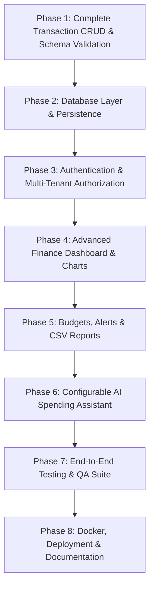

# SpendSense AI — Comprehensive Project Audit & Implementation Plan

**Auditor:** Senior Full-Stack Engineer, Backend Architect & Security Reviewer  
**Date:** October 2026  
**Project:** SpendSense AI (AI-Powered Personal Finance & Expense Management)

---

## 1. Executive Summary & Architecture Overview

SpendSense AI is designed as a modern full-stack personal finance application. The current repository contains:
- **Backend:** FastAPI (Python 3.11) with Uvicorn.
- **Frontend:** React 19 bootstrapped with Vite in JavaScript.

While an initial prototype was built with working in-memory transaction addition and deletion, critical architecture gaps exist across persistence, API contracts, user authentication, data authorization, dashboard visualization, financial calculations, and AI assistant infrastructure.

---

## 2. Existing Working Features

1. **Root Health/Info Endpoint (`GET /`)**:
   - Responds with app name, welcoming message, and version `1.0.0`.
2. **In-Memory Transaction Creation (`POST /expenses`)**:
   - Accepts title, amount, category, and type (`income` vs `expense`).
   - Generates an auto-incrementing integer ID in memory.
3. **In-Memory Transaction Listing (`GET /expenses`)**:
   - Returns the list of currently added transactions.
4. **Basic Transaction Deletion (`DELETE /expenses/{expense_id}`)**:
   - Filters out transactions with the matching ID from the Python array.
5. **Basic Frontend UI (`App.jsx`)**:
   - Branding section with SpendSense illustration, React, and Vite logos.
   - Status banner showing backend API connectivity and version.
   - Summary cards displaying Total Expenses, Total Income, and Transaction Count.
   - Form for inputting title, amount, category, and income/expense type.
   - History ledger displaying transactions with delete buttons.

---

## 3. Identified Defects, Gaps & Security Vulnerabilities

### A. Code Placement & Structure Deficiencies
- **Misplaced Backend Source Code:** `main.py` was mistakenly placed directly inside `backend/.venv/main.py`. The virtual environment directory should strictly contain virtual environment packages and binaries, not application source code.
- **Nested Frontend Directory:** The frontend was created as `frontend/frontend` (a nested Vite template inside a pre-created `frontend` folder).
- **Monolithic Architecture:** All backend routes, schemas, and state were stored in a single 60-line script without modular division (`models`, `schemas`, `api`, `services`, `core`, `db`).

### B. Missing & Broken API Endpoints (CRUD & HTTP Contracts)
- **Missing `GET /expenses/{expense_id}`:** No endpoint exists to fetch a single transaction by ID.
- **Missing `PUT /expenses/{expense_id}`:** No endpoint exists to edit an existing transaction.
- **Incorrect Status Codes & Error Handling on `DELETE`:**
  - `DELETE /expenses/{expense_id}` returns `200 OK` with a success message even when the ID does not exist in memory. It should return `404 Not Found`.
  - `POST /expenses` returns default `200 OK` instead of standard REST `201 Created`.
- **Root Key Mismatch:** Root endpoint returned `{"app name": ...}` with a space; frontend had to use fallback `backendData.app_name || backendData['app name']`.

### C. Validation & Data Integrity Issues
- **Title Validation:** Blank whitespace strings (e.g. `"   "`) are not stripped or rejected by backend validation if provided.
- **Amount Precision:** Amounts were stored as raw `float`. Floating-point arithmetic introduces rounding inaccuracies for currency (e.g. `0.1 + 0.2 = 0.30000000000000004`). Should use `Decimal` or rounded float representations.
- **Missing Transaction Date:** The backend does not record a transaction timestamp or date. Transactions in financial software must have an associated date.
- **Unrestricted Category:** Categories were open strings rather than validated against standard financial categories.

### D. Persistence Limitations
- **In-Memory Volatility:** All transactions are stored in a Python list `expenses = []`. Any server reload or restart destroys all ledger data.
- **No Database Engine:** No SQLAlchemy models, session management, connection pooling, or Alembic migrations were configured.

### E. Security & Authorization Issues
- **No User Authentication:** No registration, login, password hashing, or JWT token verification.
- **Multi-Tenant Data Leak:** Any user querying `/expenses` can view, alter, and delete financial records created by any other user. Financial records are public to any HTTP client.
- **CORS Configuration:** CORS only allowed `http://localhost:5173`. When accessing via `http://127.0.0.1:5173` or network IPs, browser requests were blocked.
- **Missing Environment Security:** No `.env.example` existed; hardcoded secrets would easily happen without a clean configuration module.

### F. Frontend UX & Dashboard Gaps
- **Missing Edit Capability:** No edit button, edit form, or update flow exists.
- **Missing Balance Metric:** Dashboard shows income and expense, but no net Current Balance (`Income - Expense`).
- **No Visual Analytics:** Recharts or charts are absent; no monthly trends or category breakdowns.
- **No Search or Filtering:** Users cannot filter by date range, category, or type, and cannot search by title.
- **No Budgets Management:** Missing budget setting, category limit warnings, and spending percentages.
- **No Reports or Export:** No monthly reporting or CSV export features.

### G. AI Spending Assistant Deficiencies
- No assistant endpoint or service module existed.
- No LLM provider abstraction (OpenAI, Gemini, Anthropic, Groq, local fallback).
- No defense against prompt injection, hallucinated financial calculations, or cross-tenant data leaks.

### H. Testing & Quality Deficiencies
- **Zero Automated Tests:** No pytest unit/integration tests for backend; no frontend test coverage.
- **No Containerization:** No Dockerfile, Docker Compose, or deployment configuration.

---

## 4. Ordered Implementation Plan

### Phase 1: Complete Transaction CRUD & Contract Standardization
- Move backend source out of `.venv` to proper modular structure while maintaining backward-compatible launcher.
- Implement `GET /expenses`, `POST /expenses` (201 Created), `GET /expenses/{id}` (404 handled), `PUT /expenses/{id}` (update validation), and `DELETE /expenses/{id}` (404 handled).
- Standardize Pydantic schemas: validate positive amount, strip whitespace on titles, validate category & type, add transaction date.
- Frontend: Add inline or modal Edit mode, input validation, loading/error states, duplicate submission prevention, and update balance/totals.

### Phase 2: Database Persistence (SQLAlchemy 2.x & Alembic)
- Configure SQLAlchemy with environment variable `DATABASE_URL`. Support PostgreSQL with SQLite automatic fallback for local zero-config execution.
- Create `Transaction` / `Expense` SQLAlchemy model.
- Configure Alembic migration environment and initial migration.
- Verify transactions survive server restarts.

### Phase 3: Authentication & User Data Security
- Implement User model (`id`, `email`, `hashed_password`, `full_name`, `created_at`).
- Secure password hashing using bcrypt.
- JWT authentication (`/api/v1/auth/register`, `/api/v1/auth/login`, `/api/v1/auth/me`).
- Dependency injection `get_current_active_user`.
- Enforce user isolation: every transaction and budget is strictly tied to `user_id`. Add tests ensuring User A cannot read/modify User B's data.

### Phase 4: Finance Dashboard (Charts, Filters, Search & Net Balance)
- Integrate Recharts: Monthly Income vs Expenses bar chart, Category expense breakdown pie chart.
- Add Net Balance card with positive/negative color indicators.
- Add Search bar by title, category filter dropdown, type filter, and date-range pickers.
- Add pagination / responsive ledger list.

### Phase 5: Budgets, Utilization & Reports
- Budget model: category, monthly limit, user_id, month/year.
- Server-side calculation of spent amount, remaining budget, and utilization percentage.
- Spending warnings (>=80% warning, >=100% exceeded).
- CSV export endpoint (`GET /api/v1/reports/export-csv`) streaming user's filtered ledger.
- Monthly financial summary report endpoint.

### Phase 6: AI Spending Assistant Integration
- Modular AI service with provider abstraction:
  - `BaseAIProvider` interface.
  - Implementations for Gemini, OpenAI, Groq, and a deterministic Mock provider for offline testing.
- Secure RAG/Grounding: Assist queries by feeding verified database statistics (user-scoped totals, category spending, top expenses, budget overruns) into system prompts.
- Never allow arbitrary SQL or data manipulation from AI suggestions.
- Add interactive frontend AI assistant chat drawer/widget.

### Phase 7: Testing & Quality Assurance
- Pytest suite covering:
  - CRUD operations & input validation
  - Authentication & JWT token validity
  - Multi-tenant isolation verification
  - Budget calculations & alerts
  - AI service provider fallback & grounding
- Frontend test / lint verification.

### Phase 8: Docker & Deployment Preparation
- Backend Dockerfile & Frontend Dockerfile.
- `docker-compose.yml` linking FastAPI, React, and PostgreSQL.
- `.env.example`, `.dockerignore`, `.gitignore`.
- Health check endpoints (`/health`).
- Complete documentation (`README.md`, `IMPLEMENTATION_PROGRESS.md`).
